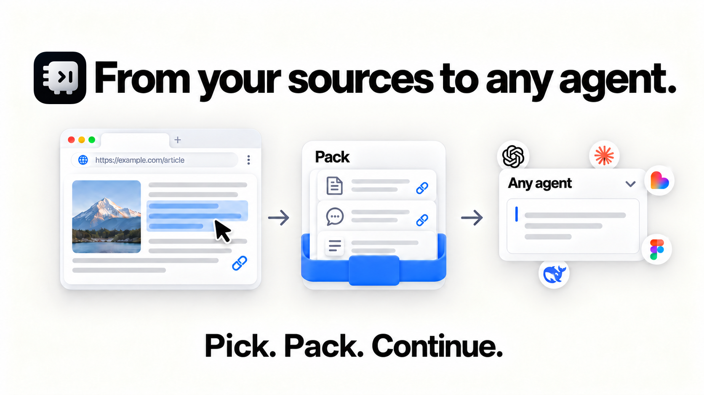
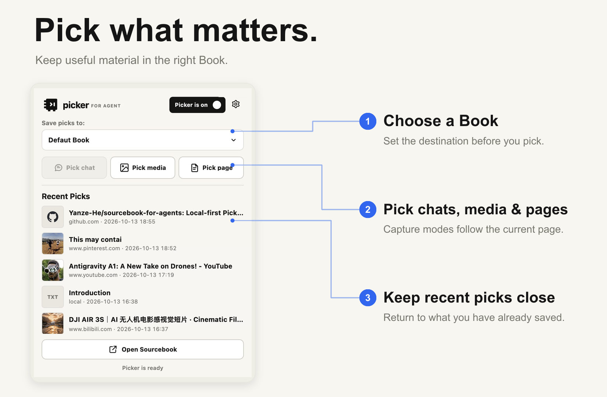
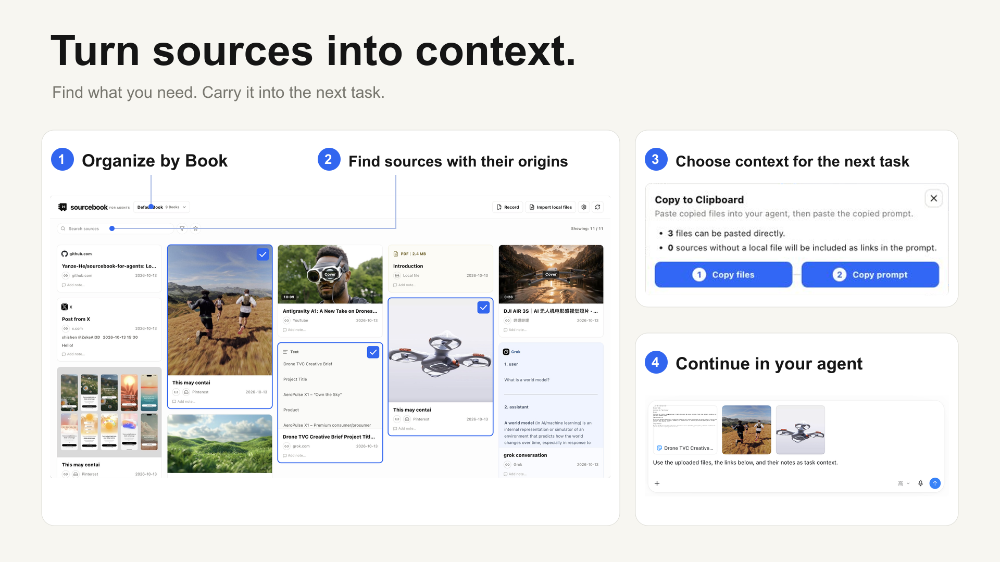

English · <a href="README.zh-CN.md">简体中文</a>

  

# Sourcebook

**A local-first creative library for AI creators.**

Organize each project in its own Book. Collect references, files, links, posts, and AI conversations, then continue with your chosen agent through Connect or Pack.

## At a glance

| Workflow | What you can do |
| --- | --- |
| **Books** | Keep a visual, project-based feed of references and work in progress. |
| **Pick** | Collect web content, images, posts, and selected AI chat messages with their sources. |
| **Connect** | Let a compatible local agent search a selected Book and submit suggestions for your review. |
| **Pack** | Select materials, add creative notes, and copy context for the AI tool you choose. |
| **Back up** | Export and restore Books with a `.sourcebook-backup` archive. |

## Pick from the browser

**Sourcebook Picker** is a Chrome extension for collecting materials from webpages, feeds, and AI conversations.

| Material | Sources | Saved content |
| --- | --- | --- |
| Text and pages | Webpages | Selected passages, page details, and source links |
| Images | Webpages | Supported images and their source links |
| AI conversations | ChatGPT, Gemini, DeepSeek, Grok | Selected or loaded messages with roles |
| Posts | X, Xiaohongshu | Post text, author, available metadata, and cover |
| Video and audio | Webpages | Media links and available previews |

Picker tries to save images locally when possible. Some sites restrict downloads; video and audio remain source references, and page Picks are not full-page archives. See [supported sites and limits](docs/supported-sites.md).

  

## Keep a project together

Create a Book for each project and browse its materials in a visual feed. Import local documents and media, write your own records, add notes, search, filter, and revisit original sources.

  

## Connect or Pack

| Connect a local agent | Pack for any AI tool |
| --- | --- |
| Compatible MCP agents—including Codex, Claude Code, WorkBuddy, and Grokbot—can search and read a selected Book. They can prepare context files and submit suggestions; you review every suggestion in Sourcebook. | Select materials, add notes, then copy the prompt and available files or links. Paste them into Codex, Claude Code, Figma, Lovable, or another AI tool. |

Sourcebook agents do not directly change or delete Book content. You choose what is saved and what is shared.

See the [Agent connection guide](docs/connect-agents.md).

## Local-first, with backup and restore

Your Books and files stay on your computer. Sourcebook has no account or cloud sync.

Export one, several, or all Books to a `.sourcebook-backup` archive, then import them on this or another device. Backups include Book data and local files; Desktop settings are not included. You can add the backed-up Books or replace the library during import.

## Install

1. Download and install [Sourcebook Desktop](https://github.com/Yanze-He/sourcebook-for-agents/releases).
2. Install [Sourcebook Picker from the Chrome Web Store](https://chromewebstore.google.com/detail/sourcebook-picker/pkglhngkfkjblabnhgcioindjgffgfpf?hl=en-US&utm_source=github_agents_readme&utm_medium=referral&utm_campaign=picker_install).
3. Start Desktop, open Picker, and choose a Book.
4. To connect an agent, open **Settings → Connect an Agent** and follow the setup prompt. To Pack, select materials, add notes, and choose **Pack for agent**.

The current beta supports Apple silicon macOS and Windows x64. Picker works with Chrome and Edge. See [Getting Started](docs/getting-started.md) for setup and troubleshooting.

## Contribute

Issues and pull requests are welcome. Areas include:

| Area | Contribution ideas |
| --- | --- |
| [Pick](docs/contribution/pick.md) | Add supported sites, chats, or material types; improve extraction and source retention. |
| [Sourcebook](docs/contribution/sources.md) | Improve organization, search, filtering, and material details. |
| [Pack](docs/contribution/pack.md) | Improve agent handoffs and context prompts. |

See [CONTRIBUTING.md](CONTRIBUTING.md) for setup and conventions. Development checks: `npm test` and `npm run build`.

## License

Sourcebook for Agents is released under the [MIT License](LICENSE).

## Documentation

[Use cases](docs/use-cases.md) · [Supported sites](docs/supported-sites.md) · [Connect an agent](docs/connect-agents.md) · [Architecture](docs/architecture.md) · [Local API](docs/local-api.md) · [Privacy](docs/privacy.md)
