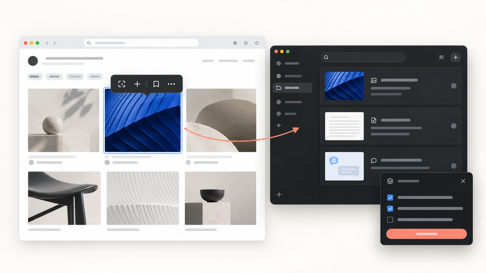
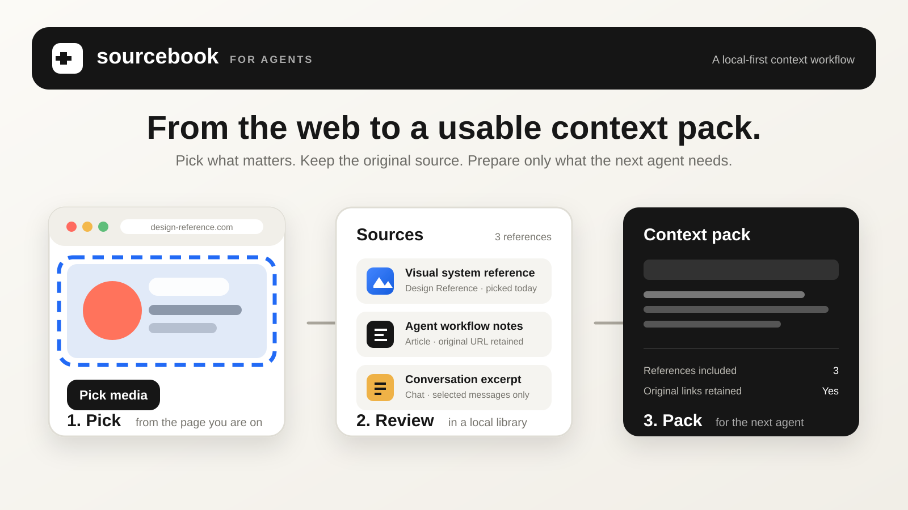

# Sourcebook for Agents

> A local-first context library for the work you want to carry from the web into your next agent task.

<p align="center">
  
</p>

Sourcebook for Agents keeps useful web context together without turning it into another chat product. Pick the references that matter while you browse, review them in a local library, and prepare a deliberate context pack for the next agent.

There are no accounts, cloud sync, or hidden uploads in the core product. Your library lives on your computer, and you decide what leaves it.

## The Product Loop

<p align="center">
  
</p>

| Step | What happens | Why it matters |
| --- | --- | --- |
| **1. Pick** | Collect selected text, links, images, page details, and supported chat messages from the page you are already viewing. | Keep research in its original context rather than rebuilding it from memory. |
| **2. Sources** | Review every reference in a local, book-based library with its title, source URL, timestamp, and available media. | See what you have, remove noise, and retain provenance. |
| **3. Pack** | Select the Sources and notes needed for one task. | Give another agent concise, traceable context instead of a long, unstructured prompt. |

## What It Is, and Is Not

**Sourcebook is a context layer.** It helps you collect and prepare material for ChatGPT, Gemini, DeepSeek, Grok, or another agent you already use.

It is **not** a new AI chat surface, an automatic web scraper, cloud storage, a team workspace, or a full-page archive. You pick content intentionally; Sourcebook records where it came from and keeps it ready for later use.

## What You Can Pick

- Selected web text, links, lightweight page cards, and individual images.
- Image files in PNG, JPEG, GIF, and WebP when the browser or source allows a local copy.
- Video and audio as source links rather than downloaded media files.
- Individual, selected, or currently loaded messages from **ChatGPT, Gemini, DeepSeek, and Grok**.

Every Pick retains useful provenance: its title, source URL, timestamp, and a locator or metadata record. Chat and link entries use the site favicon in the Sources list; locally saved images can be previewed from the same place.

Read the full [supported-sites guide](docs/supported-sites.md) before relying on a site-specific flow.

## Local-First by Design

<p align="center">
  
</p>

- The Desktop app runs a service on `127.0.0.1` only.
- Books are isolated local SQLite databases with their own asset folders.
- Sourcebook does not operate a cloud API for your picked content.
- A context pack is assembled only when you choose its Sources and notes; sending or pasting it into an AI product remains your action.

For the data model and runtime boundary, read the [architecture guide](docs/architecture.md). For data handling details, read the [privacy policy](docs/privacy.md).

## Quick Start

### 1. Run Sourcebook from source

**Requirements:** Node.js 22.18+ and npm.

```bash
git clone https://github.com/Yanze-He/sourcebook-for-agents.git
cd sourcebook-for-agents
npm run setup
npm run build
npm run dev:desktop
```

The Desktop starts the local Sources app in your default browser. It stores data on your computer:

- macOS: `~/Library/Application Support/Sourcebook for Agents`
- Windows: `%APPDATA%\\Sourcebook for Agents`

### 2. Load the Picker extension

1. Open Chromium's extension management page.
2. Enable **Developer mode**.
3. Select **Load unpacked**.
4. Choose `apps/picker/.output/chrome-mv3`.
5. Open a webpage, open the extension, and turn **Picker** on.

Keep the Desktop running while you use Picker. If the extension cannot reach the local application, it shows an explicit reconnect state instead of silently creating a separate cloud or account workflow.

## Release Security

Release automation builds and tests artifacts only. macOS signing and Apple notarization happen on a maintainer-controlled Mac, then the completed DMG and its checksum are uploaded manually to GitHub Releases. The Developer ID private key and notarization credentials never enter this repository or GitHub Actions.

For the first end-to-end session and common checks, see [Getting Started](docs/getting-started.md).

## Current Scope

Sourcebook for Agents is an early local-first P1 focused on **Pick -> Sources -> Pack**.

Included today:

- Chrome and Chromium browser support.
- Local SQLite storage, local image caching, Books, and Pack preparation.
- macOS and Windows Desktop packaging scripts.
- Pick support for ChatGPT, Gemini, DeepSeek, and Grok.

Not included today:

- Cloud sync, accounts, teams, billing, or a hosted Sources app.
- Full-page snapshots, OCR, ASR, or video downloads.
- Firefox and Safari support.

## Documentation

| Need | Read |
| --- | --- |
| Install and use the product | [Getting Started](docs/getting-started.md) |
| Understand supported sites and media behavior | [Supported Sites and Limitations](docs/supported-sites.md) |
| Understand the local runtime and storage model | [Architecture](docs/architecture.md) |
| Integrate with the local API | [Local API Contract](docs/local-api.md) |
| Review data handling | [Privacy Policy](docs/privacy.md) |
| Build or extend a module | [Contribution guides](docs/contribution/) |
| Package a release | [Release and Deployment](docs/release-and-deployment.md) |

## Repository Map

| Area | Path | Responsibility |
| --- | --- | --- |
| Pick | `apps/picker` | Chromium extension, page and chat Pick logic, Picker UX |
| Sources | `apps/sources/src` | Source list, previews, selection, and local Sources UX |
| Pack | `apps/sources/server` | Local API, media cache, Book operations, and Pack preparation |
| Desktop | `apps/desktop` | Local startup, browser launch, data directories, and installers |

## Development

```bash
npm test
npm run build
```

See [CONTRIBUTING.md](CONTRIBUTING.md) for repository-wide conventions and the focused guides in `docs/contribution/` for module boundaries.
