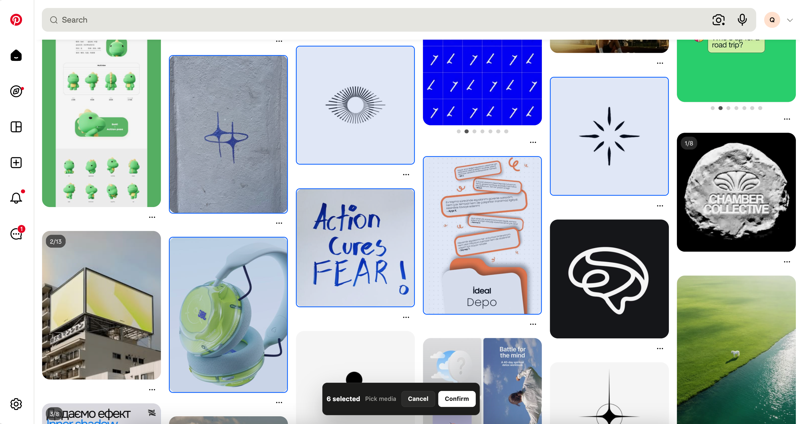
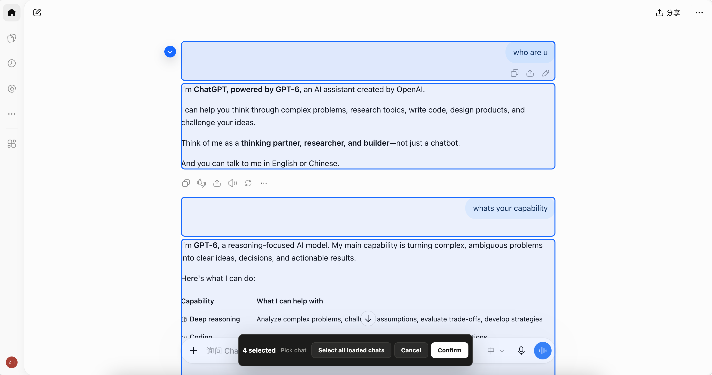

<p align="center">
  
</p>

# Sourcebook for Agents

Sourcebook keeps web material, AI conversations and local files together, ready to reuse with the agent you choose.

For researchers, designers, creators and people working across AI tools:

- **Research & planning:** Bring references and useful AI answers together for the next analysis or brief.
- **Design & creation:** Keep visual references, posts and project files in one Book.
- **Switching agents:** Carry selected context into the next task without repeating the whole backstory.

## Pick

Save useful material from webpages and supported AI chats into a Book, with its original source attached.

<p align="center">
  
</p>

| Type | Sources | Saved content |
| --- | --- | --- |
| Text | Webpages | Selected passages and source links |
| Images | Webpages | PNG, JPEG, GIF, WebP and source links |
| AI conversations | ChatGPT, Gemini, DeepSeek, Grok | Selected or currently loaded messages and their roles |
| Posts | X / Twitter, Xiaohongshu | Post text, author, available metadata and cover |
| Pages & links | Webpages | URL, title and available page metadata |
| Video & audio | Webpages | Media links and available previews |

Picker automatically tries to save images locally; blocked downloads remain source links. Web video and audio stay as references, and page Picks are not full-page archives. [Supported sites and limits](docs/supported-sites.md).

### Pick media in one pass

Select the images that matter on a page, then save them to the chosen Book together.

<p align="center">
  
</p>

### Pick the useful turns from a chat

Select the messages worth keeping—across one or more exchanges—without saving the whole conversation.

<p align="center">
  
</p>

## Organise & Pack

Keep materials in Books, add notes, search and filter. Import local documents and media, or write your own records.

Select the material for one task, then copy its files and prompt into your chosen agent. Sources without copyable files are included as links.

Customise the prompt in **Settings → Prompt settings**, using source titles, notes, file names and links. Preview the result or restore the default template.

<p align="center">
  
</p>

## Local-First

Your Books and files stay on your computer. No accounts, cloud sync or hidden uploads.

- **Export:** choose one, several or all Books for a `.sourcebook-backup` archive.
- **Import:** add backed-up Books or explicitly replace the library. Cancelling either choice leaves the current library unchanged.

Both are available in **Settings**. Backups contain Book data and local files, not Desktop settings. You decide what to share with an agent.

## Connect a Local Agent

The **Sourcebook Agent Plugin** works with compatible local Agents, including Codex, Claude Code, WorkBuddy, Grokbot, Cursor, VS Code/Copilot, Gemini CLI, and Windsurf. It lets an Agent read and search a selected Book through Desktop's controlled local interface. Agents can prepare explicitly selected temporary context files and submit suggestions; they cannot directly change or delete Book content. You review every suggestion in Sourcebook.

Open **Settings → Connect an Agent**, approve access, choose Codex, WorkBuddy, or a compatible MCP Agent, then send it the generated install/update prompt. The Agent fetches a separately versioned Plugin from GitHub, verifies it, and installs or updates its own integration. Sourcebook Desktop is required; if it is not installed, the Agent directs you to [sourcebook.online](https://sourcebook.online). Then ask your connected Agent to open Sourcebook and choose a Book—`@` and `/` are optional host shortcuts, not requirements. [Agent connection guide](docs/connect-agents.md).

## Get Started

The current beta needs macOS (Apple silicon) and Chrome or another Chromium browser, including Edge.

1. Download and install Desktop from the [Releases page](https://github.com/Yanze-He/sourcebook-for-agents/releases), then install [Sourcebook Picker from the Chrome Web Store](https://chromewebstore.google.com/detail/sourcebook-picker/pkglhngkfkjblabnhgcioindjgffgfpf?hl=en-US&utm_source=github_agents_readme&utm_medium=referral&utm_campaign=picker_install).
2. Start Desktop, open Picker on a webpage, turn it on and choose a Book.

Keep Desktop running while using Picker. See [Getting Started](docs/getting-started.md) for installation, release verification and troubleshooting.

### From Source

Requires Node.js 22.18+, npm and Go 1.24.3+.

```bash
git clone https://github.com/Yanze-He/sourcebook-for-agents.git
cd sourcebook-for-agents
npm run setup
npm run build
npm run dev:desktop
```

When running from source, load `apps/picker/.output/chrome-mv3` as the unpacked extension.

## Contribute

- **[Pick](docs/contribution/pick.md):** more websites, AI chats and material formats; better extraction and source retention.
- **[Sourcebook](docs/contribution/sources.md):** better information on cards and in details; improved organisation, search, filtering and batch management.
- **[Pack](docs/contribution/pack.md):** test and adapt handoffs to more agents; explore prompt templates for research, design and creation tasks.

Run `npm test` and `npm run build` for development checks. See [CONTRIBUTING.md](CONTRIBUTING.md) for conventions and module boundaries.

## Docs

[Use Cases](docs/use-cases.md) · [Supported Sites](docs/supported-sites.md) · [Connect an Agent](docs/connect-agents.md) · [Architecture](docs/architecture.md) · [Local API](docs/local-api.md) · [Privacy](docs/privacy.md) · [Release & Deployment](docs/release-and-deployment.md)

## License

Sourcebook for Agents is available under the [MIT License](LICENSE).
