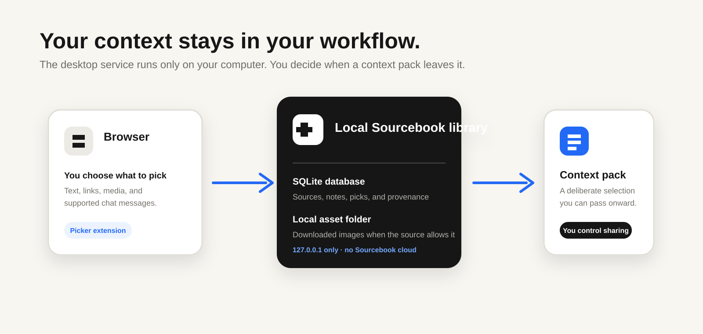

# Architecture

<p align="center">
  
</p>

Sourcebook is intentionally a local product loop. The browser extension collects user-selected material, the local service stores it in an active Book, and Sources lets the user prepare a context pack. No Sourcebook-operated cloud service is part of this runtime.

## Product Loop

The public-ready local loop is **Pick -> Sources -> Pack**.

- **Picker** (`apps/picker`) is the Chrome/Chromium extension. It recognizes selectable webpage material, creates versioned Pick payloads, and sends them to Sourcebook Desktop through the local connection.
- **Sources** (`apps/sources`) is the web interface for browsing, editing, selecting, importing, and preparing Sources.
- **Desktop** (`apps/desktop`) starts the local service, owns the library location, opens Sources in the default browser, and packages the macOS and Windows application.
- **Local service** (`apps/service-go`) owns Book databases, file copies, backups, imports, transfer operations, Pack assembly, and the protected MCP bridge.
- **Sourcebook MCP** (`apps/mcp-go`) is a native stdio helper packaged only with Desktop. Desktop also installs a small, fixed-path bootstrapper (`apps/mcp-launcher-go`) in its private data directory. Codex and WorkBuddy register that bootstrapper once; it reads Desktop's current installation marker and starts the current packaged helper, so ordinary Desktop updates do not change an Agent configuration. The helper uses the stable `sourcebook` namespace and only the local service's paired bridge API; it never opens Book SQLite files or asset folders. Its server instructions and tool descriptions are the sole runtime guidance; Sourcebook does not ship a separate Agent Skill.

## Local Storage

A Sourcebook library contains isolated Books:

```text
Sourcebook Library/
  library.json
  books/
    sourcebook/
      book.sqlite
      assets/
```

Each Book has its own SQLite database and asset directory. New Books receive a random UUIDv4 that remains stable when renamed; their human-readable folder name is stored separately. Existing name-based IDs remain unchanged to keep existing Picker selections, backups, and media links valid. The active Book is explicit in every Pick request. A Source can move or copy to another Book only through the transfer API.

## API Boundary

Picker sends `POST /api/picks`. Sources is read through `GET /api/sources?bookId=…`; edits, local file operations, transfers, backups, and Packs use the matching `/api` routes. The application does not expose a cloud API in this release.

MCP uses a separate, versioned loopback bridge (`/api/mcp/v1`) with an owner-only pairing credential. It is not part of the browser API and rejects requests with a browser origin. A named Book can be resolved without changing session scope; a Book is only created or renamed after an explicit Agent call. Every MCP session explicitly selects one Book before reading sources or submitting a suggestion. MCP Source changes persist only pending suggestions; multi-item saves are stored in one durable submission batch and Sourcebook applies each suggestion through the same local transaction path after the user accepts it. A batch returns a deep link carrying its Book and review identity; the Agent host, not MCP, is responsible for presenting that link in a visible browser panel.

```text
Codex / WorkBuddy
  → stdio → fixed Sourcebook launcher
  → current Desktop sourcebook-mcp
  → paired loopback bridge → Sourcebook Desktop service
  → controlled Book API → SQLite and managed source files
```

The extension should only expose collection controls when the local application is reachable. A failed refresh is visible to the user rather than treated as an implicit remote fallback.

## Packaging

Desktop packages the Sources build, service, MCP helper, and stable bootstrapper. Users explicitly connect an Agent from Desktop. Codex registration is added only when the same-named server is Desktop-managed; WorkBuddy changes only `mcpServers.sourcebook`, preserves all other entries, and always requires the user's first Trust approval.
