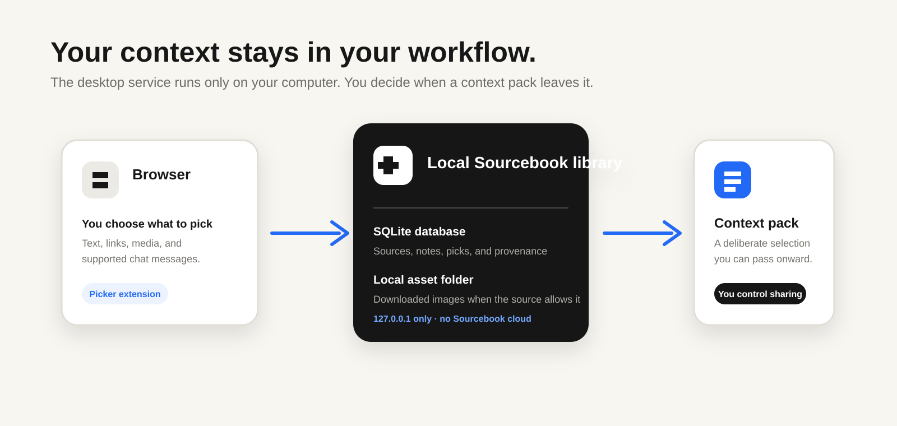

# Architecture

<p align="center">
  
</p>

Sourcebook is intentionally a local product loop. The browser extension collects user-selected material, the local service stores it in an active Book, and Sources lets the user prepare a context pack. No Sourcebook-operated cloud service is part of this runtime.

## Product Loop

The public-ready local loop is **Pick -> Sources -> Pack**.

- **Picker** (`apps/picker`) is the Chrome/Chromium extension. It recognizes selectable webpage material, creates versioned Pick payloads, and sends them to Sourcebook Desktop through the local connection.
- **Sources** (`apps/sources`) is the web interface for browsing, editing, selecting, importing, and preparing Sources.
- **Desktop** (`apps/desktop`) starts the local service, owns the library location, opens Sources in the default browser, and packages the macOS and Windows application.
- **Local service** (`apps/service-go`) owns Book databases, file copies, backups, imports, transfer operations, and Pack assembly.

## Local Storage

A Sourcebook library contains isolated Books:

```text
Sourcebook Library/
  library.json
  books/
    sourcebook/
      book.sqlite
      assets/
```

Each Book has its own SQLite database and asset directory. The active Book is explicit in every Pick request. A Source can move or copy to another Book only through the transfer API.

## API Boundary

Picker sends `POST /api/picks`. Sources is read through `GET /api/sources?bookId=…`; edits, local file operations, transfers, backups, and Packs use the matching `/api` routes. The application does not expose a cloud API in this release. See [the local API contract](local-api.md) for the MCP-ready Source creation endpoint.

The extension should only expose collection controls when the local application is reachable. A failed refresh is visible to the user rather than treated as an implicit remote fallback.

## Packaging

Desktop packages embed the Sources build and service. The application runs the service on loopback, opens it in the system browser, and retains native ownership of SQLite and local files without Electron.
